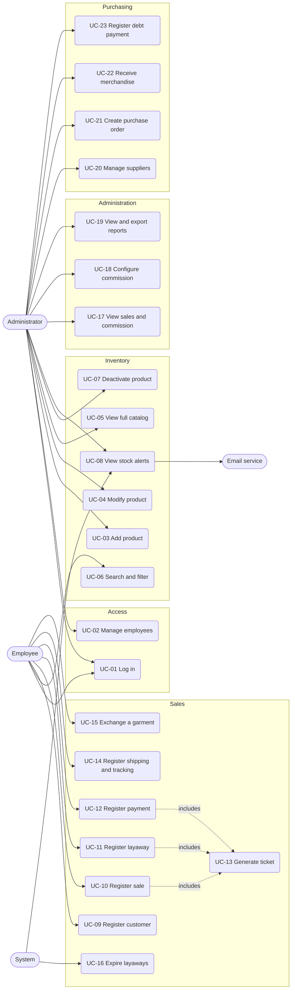
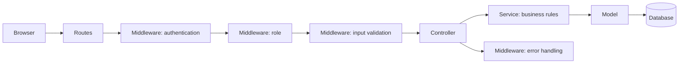

# Project Planning

Web system for sales, layaways, inventory, purchasing, and supplier debts for a clothing store.
Courses: **Systems Analysis and Design** + **Web Systems Programming**.

---

## Context and scope

**Problem:** the store tracks sales, layaways, stock, and debts manually. This makes it hard to know what is available, how much is owed to suppliers. In addition, part of the sales happen through social media (WhatsApp and Facebook) and are shipped by courier.

**Goal:** a web system that registers sales and layaways with payments, controls inventory with alerts, manages shipments with the Estafeta tracking number, calculates commisions, restocks merchandise from suppliers, tracks supplier debts, and provides reports.

**In scope:** the 20 user stories (S1 to S20). **Out scope:** 

### Actors

| Actor | Type | Description |
|---|---|---|
| **Administrator** | System user | Manages products, reports, commissions, purchases, debts, and employee accounts. Can do everything an employee can do |
| **Employee** | System user | Registers sales, layaways, payments, customers, and shipments; consults the catalog |
| **Customer** | External (no access) | Buys, reserves, and requests exchanges; their data is entered by the employee |
| **Supplier** | External (no access) | Supplies merchandise; receives purchase orders and payments |
| **Estafeta** | External | Delivers shipments; the system only stores the tracking number and tracking link |
| **Email service** | External | Sends the stock alert email |
| **System (scheduled task)** | Internal | Expires layaways and generates alerts automatically |

---

## Functional requirements

| ID | Requirement | Story | Priority |
| --- | --- | --- | --- |
| RF-01 | The system must authenticate users with email and password and apply permissions by role (owner and employee) | S13 | High |
| RF-02 | The owner must be able to add products with their variants (brand, size and color), price, initial stock, and supplier | S2 | High |
| RF-03 | The owner must be able to modify products (price, supplier, stock), keeping a change history | S6 | High |
| RF-04 | The owner must be able to view the complete catalog, sort it, and go to edit | S9 | Medium |
| RF-05 | Users must be able to search and filter the catalog by name, size, brand , color, and department, seeing available stock | S5 | High |
| RF-06 | The owner must be able to deactivate products and reactivate them | S8 | Medium |
| RF-07 | The system must generate out-of-stock and low-stock alerts (minimum per product), show them in the app, and send them by email | S7 | Medium |
| RF-08 | The employee must be able to craete, search, and view customers (name, phone, profile) with their purchase history | S12 | High |
| RF-09 | The employee must be able to register a sale with garments, customer, and payment, deducting inventory | S1 | High |
| RF-10 | The employee must be able to register a layaway with a down payment, reserving the garments for 30 days | S1 | High |
| RF-11 | The system must generate a printable or PDF ticket with the sale data and store policies | S1 | Medium |
| RF-12 | Each payment must record amount, method (chash or transfer), and, for transfers, a mandatory reference number | S4 | High |
| RF-13 | The employee must be able to register layaway payments, see the balance, and generate a receipt | S14 | High |
| RF-14 | The system must automatically expire unpaid layaways after 30 days, release the garments | S17 | Medium |
| RF-15 | The employee must be able to exchange garments (same or higher price, unused with tags, ticket presented) and exchange for factory defects; there are no cash refunds | S16 | Medium |
| RF-16 | The employee must be able to register the shipping address and the Estafeta tracking number, and share the tracking link | S10 | Medium |
| RF-17 | Each sale must be linked to the employee who made it; the owner must be able to configure the commission and view commission per employee  | S11 | Medium |
| RF-18 | The owner must be able to view sales reports by period, product, department, employee, and payment  | S3 | High |
| RF-19 | The owner must be must be able to create purchase orders to suppliers and record the receipt of merchandise, increasing inventory | S15 | High |
| RF-20 | The owner must be able to record supplier debts (credit purchases), their payments, and view the total debt | S18 | Low |
| RF-21 | The administrator must be able to add, modify, delete (soft delete), and reactivate employee accounts, and create other administrators; deleted employees can no longer log in but keep their sales history | S19 | High |
| RF-22 | Users must be able to change their own password; accounts created with a temporary password must change it at first login; only administrators manage contact data | S20 | High |

---

## Non-functional requirements

| ID | Category | Requirement |
| --- | --- | --- |
| RNF-01 | Security | Comply with `security.md`: authentication, correct HTTP codes, server-side role-based authorization, no exposed secrets, input validation |
| RNF-02 | Performance | Catalog search and sale registration in under 2 seconds with up to ~300 products |
| RNF-03 | Usability | Interface in Spanish, usable on computers and phone |
| RNF-04 | Integrity | Operations touching inventory and payments (sale, layaway payment, exchange, receiving) must be atomic: if something fails, nothing is left half done |
| RNF-05 | Maintainability | Separated routes, middlewares, controllers, services, and models; no duplicated code |
| RNF-06 | Quality | Integration and E2E tests; minimum 90% coverage in the final delivery |
| RNF-07 | Deployment | Reproducible infraestructure and deployment with documented instructions and no secrets in the repository |
| RNF-08 | CI/CD | The pipeline must run tests and deploy automatically |
| RNF-09 | Data | Currency in Mexican Pesos (MXN) with 2 decimals; time zone America/Mexico City
| RNF-10 | Backup | Periodic database backup; frequency: 15 days |
|||

---

## Use cases

### General diagram



*The administrator can also run every employee use case.*

### Use case summary

| ID | Use case | Main actor | Story | Requirement |
|---|---|---|---|---|
| UC-01 | Log in | Administrator, Employee | S13 | RF-01 |
| UC-02 | Manage employee accounts (add, edit, delete, reactivate, create administrators) | Administrator | S19 | RF-21 |
| UC-03 | Add product | Administrator | S2 | RF-02 |
| UC-04 | Modify product | Administrator | S6 | RF-03 |
| UC-05 | View full catalog | Administrator | S9 | RF-04 |
| UC-06 | Search and filter catalog | Employee, Administrator | S5 | RF-05 |
| UC-07 | Deactivate or reactivate product | Administrator | S8 | RF-06 |
| UC-08 | View stock alerts | Administrator, System | S7 | RF-07 |
| UC-09 | Register and search customer | Employee | S12 | RF-08 |
| UC-10 | Register sale | Employee | S1 | RF-09 |
| UC-11 | Register layaway | Employee | S1 | RF-10 |
| UC-12 | Register payment or layaway payment | Employee | S4, S14 | RF-12, RF-13 |
| UC-13 | Generate ticket or receipt | Employee | S1 | RF-11 |
| UC-14 | Register shipping and tracking number | Employee | S10 | RF-16 |
| UC-15 | Exchange a garment | Employee | S16 | RF-15 |
| UC-16 | Automatically expire layaways | System | S17 | RF-14 |
| UC-17 | View sales and commission per employee | Administrator | S11 | RF-17 |
| UC-18 | Configure commission | Administrator | S11 | RF-17 |
| UC-19 | View and export reports | Administrator | S3 | RF-18 |
| UC-20 | Manage suppliers | Administrator | S15 | RF-19 |
| UC-21 | Create purchase order | Administrator | S15 | RF-19 |
| UC-22 | Receive merchandise | Administrator | S15 | RF-19 |
| UC-23 | Register supplier debt and payment | Administrator | S18 | RF-20 |
| UC-24 | Change own password | Employee, Administrator | S20 | RF-22 |

### Description of the main use cases

#### UC-02: Manage employee accounts
- **Actor:** Administrator.
- **Preconditions:** logged in as administrator.
- **Main flow:**
  1. The administrator opens "Employees" and sees the list with status.
  2. To add: enters name, email, phone, role (Employee or Administrator), and a temporary password. To edit: changes contact data. To reset: sets a new temporary password. To delete: confirms the soft delete. To reactivate: selects a deleted employee.
  3. The system validates, saves the change, and hashes any password.
- **Alternate flows:** email already registered → rejected (409); invalid data → rejected (422); deleting their own account or the last administrator → blocked (409); an employee tries to access this screen → 403.
- **Postconditions:** new and reset accounts must change the temporary password at first login (UC-24); a deleted employee cannot log in and their open sessions stop working; their past sales, payments, and exchanges stay in the history.
- **Rules:** deletion is a soft delete (`activo = false`) so history and commissions are not lost; only administrators edit contact data.

#### UC-24: Change own password
- **Actor:** Employee or Administrator.
- **Main flow:** the user opens "My account" (or is sent there after logging in with a temporary password) → enters current and new password → the system validates, stores the new hash, clears the must-change flag, and closes the user's other sessions.
- **Alternate flows:** wrong current password → 422; weak or repeated password → 422; with a temporary password, any other route → 403 until changed.

#### UC-10 / UC-11: Register a sale or layaway
- **Actor:** Employee.
- **Preconditions:** logged in; products with available stock exist.
- **Main flow:**
  1. The employee searches for the product (UC-06) and adds the garments with their quantity.
  2. Selects or creates the customer (UC-09).
  3. Chooses "Sale" or "Layaway". If it is shipped, registers the address (UC-14).
  4. Registers the payment: method and amount (down payment if layaway). If it is a transfer, enters the reference.
  5. The system validates, saves the sale, deducts the stock (or reserves it if layaway), and calculates the balance.
  6. The system generates the ticket (UC-13).
- **Alternate flows:**
  - 3a. A garment without stock: the system blocks it and shows a message.
  - 4a. Transfer without reference: the system rejects the payment.
  - 4b. Amount greater than the total: the system rejects it.
  - 5a. Error while saving: no stock is deducted and no payment is recorded (atomic operation).
- **Postconditions:** sale registered with the employee and the price of each garment at that moment; stock updated; for a layaway, due date = today + 30 days.
- **Rules:** a sale requires at least one garment and one customer; the employee is the one in the session and is not chosen.

#### UC-12: Register a layaway payment
- **Actor:** Employee.
- **Preconditions:** layaway with a pending balance and within the due date.
- **Main flow:** the employee finds the layaway → registers the payment (amount, method, reference) → the system updates the balance → generates the receipt with the days remaining.
- **Alternate flows:** amount greater than the balance → rejected; expired layaway → payments not accepted; balance at 0 → becomes "paid, ready for pickup".
- **Postconditions:** balance updated; if it reaches 0, the employee can mark it as delivered.

#### UC-15: Exchange a garment
- **Actor:** Employee (the administrator authorizes outside the window).
- **Preconditions:** the customer presents the ticket of a completed sale.
- **Main flow:**
  1. The employee looks up the sale by folio or customer.
  2. Confirms that the garment is clean, unused, odor-free, and with tags (normal exchange), or describes the defect (factory defect).
  3. Selects the new garment.
  4. The system compares prices: same or higher is allowed; if higher, it charges the difference.
  5. The system adjusts stock and generates the exchange ticket linked to the original sale.
- **Alternate flows:** new garment cheaper → rejected (no refund or store credit); new garment out of stock → blocked; outside the window → only the administrator authorizes.
- **Postconditions:** the returned garment is added to stock (or to defective stock, if factory-related) and the new garment is deducted from stock.

#### UC-16: Automatically expire layaways
- **Actor:** System (daily task).
- **Main flow:** each day the system finds layaways with a balance and more than 30 days → marks them as expired → releases the reserved stock → keeps the payments as retained income.
- **Postconditions:** the layaway stays in the customer's history as "expired"; it does not count as a sale or generate commission.

#### UC-22: Receive merchandise
- **Actor:** Administrator.
- **Preconditions:** pending purchase order (UC-21).
- **Main flow:** the administrator opens the order → enters received quantities and invoice number → indicates whether it was paid or on credit → the system adds the stock and, if on credit, creates the debt (UC-23).
- **Alternate flows:** quantity lower than ordered → order "partial"; negative quantity → rejected.

#### UC-23: Register a supplier debt payment
- **Actor:** Administrator.
- **Main flow:** the administrator opens the supplier → sees their debts and total debt → registers a payment (amount, method, reference) → the system updates the balance and status (partial or paid).
- **Alternate flows:** payment greater than the balance → rejected; transfer without reference → rejected.

---

## Proposed architecture design

### Request flow



### Responsibility of each layer

| Layer | Responsibility | Must not do |
|---|---|---|
| **Routes** | Declare URL and method, and chain the middlewares | Business logic |
| **Middlewares** | Authenticate, check role, validate and sanitize input, handle errors | Database queries (except checking the session) |
| **Controllers** | Receive the request, call the service, and respond with the correct HTTP code | Business rules, SQL |
| **Services** | Business rules (stock deduction, balance, deadlines, commission) and transactions | Read `req`/`res` |
| **Models** | Data access with parameterized queries | Business rules |
| **Scheduled tasks** | Expire layaways, generate alerts | Respond to HTTP |

### Folder structure

```
project/
├── src/
│   ├── routes/            # one per module: auth, productos, ventas, ...
│   ├── middlewares/       # auth, roles, validate, errorHandler
│   ├── controllers/
│   ├── services/
│   ├── models/
│   ├── validators/        # validation schemas per input
│   ├── jobs/              # layaway expiry, alerts
│   ├── config/            # reads environment variables
│   └── app.js
├── migrations/            # table creation
├── seeds/                 # test data (no real data)
├── tests/
│   ├── integration/
│   └── e2e/
├── frontend/              # screens
├── .github/workflows/     # CI/CD
├── .env.example           # variable names only, no secret values
└── README.md
```

---

## Sprint plan and goals

| Sprint | Dates | Goal | Stories (administrator) |
|---|---|---|---|
| **1: Planning** | Oct 12 and 13 | Planning documents, ER model, stories, architecture, security, repository with Gitflow and board | T-01, T-02 and the documents in this package |
| **2: First working flow** | Oct 26 and 27 | One complete flow with persistence: login with roles, product creation and catalog view, with server validation, security controls, and integration tests | S13 (B), S2 (B), S9 (C), S6 (C), S12 (A), S19 (A) |
| **3: Integration and deployment** | Nov 9 and 10 | Complete sale with ticket and payments, search, shipping; authentication and authorization everywhere; E2E; app deployed with CI/CD | S1 (A), S5 (A), S4 (B), S11 (B), S20 (B), S10 (C) + T-06 to T-09 |
| **4: Consolidation** | Nov 23 and 24 | Alerts, deactivation, purchasing, debts, and layaway payments; fix observations and vulnerabilities; raise coverage | S7 (C), S8 (C), S15 (C), S18 (B), S14 (A) |
| **Final delivery** | Dec 11 | Reports, exchanges, and layaway expiry; documentation; 90% coverage; presentation | S3 (B), S16 (A), S17 (C) + T-10, T-11 |