# Modelo entidad-relación

Sistema de ventas, apartados, inventario, compras y deudas con proveedores para una tienda de ropa.
Este modelo se deriva del diagrama de clases del equipo y de las historias S1 a S20.

**Notación:** `PK` llave primaria · `FK` llave foránea · `UK` valor único. Las cardinalidades usan notación pata de gallo.
Los valores permitidos de los campos de estado/tipo van entre comillas junto al atributo.

---

## Diagrama

```mermaid
erDiagram
    USUARIO {
        int id_usuario PK
        string nombre
        string correo UK
        string contrasena_hash "nunca texto plano"
        string rol "administrador, empleado"
        string telefono
        boolean activo "false = baja logica"
        boolean debe_cambiar_contrasena "true con contrasena temporal"
        datetime fecha_baja
        int creado_por FK "administrador que lo creo"
    }

    CLIENTE {
        int id_cliente PK
        string nombre
        string telefono UK
        string perfil_red_social
    }

    PROVEEDOR {
        int id_proveedor PK
        string nombre
        string telefono
        boolean activo
    }

    PRODUCTO {
        int id_producto PK
        int id_proveedor FK
        string nombre
        string marca
        string categoria
        string departamento
        decimal precio
        int stock_minimo "alerta por producto"
        boolean activo
        string motivo_baja "sin surtido, baja demanda, otro"
        date fecha_baja
    }

    VARIANTE {
        int id_variante PK
        int id_producto FK
        string talla
        string color
        int stock
        int stock_reservado "apartados"
        int stock_defectuoso
    }

    HISTORIAL_PRECIO {
        int id_historial PK
        int id_producto FK
        int id_usuario FK
        decimal precio_anterior
        decimal precio_nuevo
        datetime fecha
    }

    MOVIMIENTO_STOCK {
        int id_movimiento PK
        int id_variante FK
        int id_usuario FK
        int valor_anterior
        int valor_nuevo
        string motivo "ajuste, venta, compra, cambio, vencimiento"
        datetime fecha
    }

    ALERTA_STOCK {
        int id_alerta PK
        int id_producto FK
        string tipo "bajo, agotado"
        boolean vista
        boolean correo_enviado
        datetime fecha
    }

    VENTA {
        int id_venta PK
        int id_cliente FK
        int id_usuario FK
        string folio UK
        string tipo "venta, apartado"
        string estado "pagada, apartado, entregada, vencida"
        boolean es_envio
        decimal total
        datetime fecha
        date fecha_limite "30 dias si es apartado"
    }

    DETALLE_VENTA {
        int id_detalle PK
        int id_venta FK
        int id_variante FK
        int cantidad
        decimal precio_unitario "precio al momento de vender"
        decimal subtotal
    }

    PAGO {
        int id_pago PK
        int id_venta FK
        int id_cambio FK "solo si paga diferencia de cambio"
        int id_usuario FK
        decimal monto
        string metodo "efectivo, transferencia"
        string referencia "obligatoria si es transferencia"
        datetime fecha
    }

    ENVIO {
        int id_envio PK
        int id_venta FK, UK
        string calle
        string numero
        string colonia
        string ciudad
        string estado_republica
        string codigo_postal
        string telefono
        string guia_estafeta
        string estado_envio "pendiente, enviado"
    }

    CAMBIO {
        int id_cambio PK
        int id_venta FK
        int id_variante_devuelta FK
        int id_variante_nueva FK
        int id_usuario FK
        int autorizado_por FK "administrador si fuera de plazo"
        string motivo "normal, defecto_fabrica"
        string descripcion_defecto
        decimal diferencia
        datetime fecha
    }

    COMISION_CONFIG {
        int id_comision PK
        string tipo "monto_fijo, porcentaje"
        decimal valor
        date vigente_desde
    }

    CONFIGURACION {
        string clave PK "dias_apartado, dias_cambio_normal, dias_cambio_defecto"
        string valor
    }

    ORDEN_COMPRA {
        int id_orden PK
        int id_proveedor FK
        int id_usuario FK
        string numero_factura
        string estado "pendiente, parcial, recibida"
        boolean a_credito
        decimal total
        datetime fecha
    }

    DETALLE_COMPRA {
        int id_detalle_compra PK
        int id_orden FK
        int id_variante FK
        int cantidad_pedida
        int cantidad_recibida
        decimal costo_unitario
    }

    DEUDA {
        int id_deuda PK
        int id_proveedor FK
        int id_orden FK, UK
        decimal monto_original
        decimal saldo
        string estado "pendiente, parcial, pagada"
        date fecha_vencimiento "opcional"
        datetime fecha
    }

    PAGO_PROVEEDOR {
        int id_pago_proveedor PK
        int id_deuda FK
        int id_usuario FK
        decimal monto
        string metodo "efectivo, transferencia"
        string referencia
        datetime fecha
    }

    PROVEEDOR ||--o{ PRODUCTO : surte
    PRODUCTO ||--|{ VARIANTE : "tiene tallas y colores"
    PRODUCTO ||--o{ HISTORIAL_PRECIO : registra
    PRODUCTO ||--o{ ALERTA_STOCK : genera
    VARIANTE ||--o{ MOVIMIENTO_STOCK : registra
    USUARIO ||--o{ HISTORIAL_PRECIO : modifica
    USUARIO ||--o{ MOVIMIENTO_STOCK : realiza
    USUARIO ||--o{ USUARIO : crea

    CLIENTE ||--o{ VENTA : realiza
    USUARIO ||--o{ VENTA : registra
    VENTA ||--|{ DETALLE_VENTA : contiene
    VARIANTE ||--o{ DETALLE_VENTA : "se vende en"
    VENTA ||--o{ PAGO : recibe
    VENTA ||--o| ENVIO : "puede tener"
    VENTA ||--o{ CAMBIO : origina
    VARIANTE ||--o{ CAMBIO : "es devuelta en"
    VARIANTE ||--o{ CAMBIO : "es entregada en"
    CAMBIO ||--o{ PAGO : "cobra diferencia"
    USUARIO ||--o{ CAMBIO : registra

    PROVEEDOR ||--o{ ORDEN_COMPRA : recibe
    ORDEN_COMPRA ||--|{ DETALLE_COMPRA : contiene
    VARIANTE ||--o{ DETALLE_COMPRA : "se compra en"
    ORDEN_COMPRA ||--o| DEUDA : "genera si es a credito"
    PROVEEDOR ||--o{ DEUDA : "se le debe"
    DEUDA ||--o{ PAGO_PROVEEDOR : "se paga con"
```

---

## Relaciones y cardinalidades

| Relación | Cardinalidad | Explicación |
|---|---|---|
| Proveedor → Producto | 1 : N | Un proveedor surte muchos productos; cada producto tiene un proveedor principal |
| Producto → Variante | 1 : N (mínimo 1) | Un producto tiene varias combinaciones de talla y color, cada una con su stock |
| Cliente → Venta | 1 : N | Un cliente puede tener muchas compras y apartados |
| Usuario → Usuario | 1 : N | Un administrador crea otras cuentas (`creado_por`) |
| Usuario → Venta | 1 : N | Cada venta la registra un empleado (base de la comisión, S11) |
| Venta → Detalle de venta | 1 : N (mínimo 1) | Una venta tiene una o más prendas |
| Venta → Pago | 1 : N | Una venta o apartado se puede pagar en varios abonos |
| Venta → Envío | 1 : 0..1 | Solo las ventas con envío tienen domicilio y guía |
| Venta → Cambio | 1 : N | Una venta puede originar cambios |
| Cambio → Pago | 1 : N | La diferencia de un cambio se cobra con un pago |
| Proveedor → Orden de compra | 1 : N | Cada orden es de un solo proveedor |
| Orden de compra → Detalle de compra | 1 : N | Una orden incluye varias variantes |
| Orden de compra → Deuda | 1 : 0..1 | Solo las órdenes a crédito generan deuda |
| Proveedor → Deuda | 1 : N | Se suma por proveedor para saber la deuda total |
| Deuda → Pago a proveedor | 1 : N | Una deuda se paga en abonos |

## Qué historia usa cada entidad

| Entidad | Historias |
|---|---|
| Usuario | S13, S19, S20, S11, S1 |
| Cliente | S12, S1, S14 |
| Proveedor | S2, S6, S15, S18 |
| Producto | S2, S5, S6, S8, S9 |
| Variante | S2, S5, S1, S7, S16 |
| Historial de precio | S6 |
| Movimiento de stock | S6, S1, S15, S16, S17 |
| Alerta de stock | S7 |
| Venta | S1, S3, S11, S14, S17 |
| Detalle de venta | S1, S3 |
| Pago | S1, S4, S14, S16 |
| Envío | S10 |
| Cambio | S16 |
| Comisión config | S11 |
| Configuración | S1, S16, S17 |
| Orden de compra | S15 |
| Detalle de compra | S15 |
| Deuda | S18 |
| Pago a proveedor | S18 |